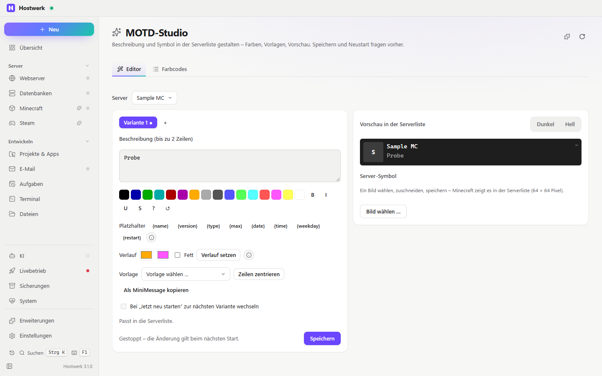

# MOTD-Studio

Die Beschreibung deines Minecraft-Servers in der Serverliste gestalten – mit Farben, Verläufen, Platzhaltern, Varianten und Vorschau wie im Spiel. Direkt in der Übersicht jedes Minecraft-Servers.

[English](README.md) · Offizielle [Hostwerk](https://github.com/Passimoritz/hostwerk-public)-Erweiterung (läuft abgeschottet, ab Hostwerk 3.1)

## Was sie kann

Dazu ein **Beispiel für eine Erweiterung, die Hostwerk selbst verändert**:

- **Abschnitt in der Übersicht jedes Minecraft-Servers** (`contributes.sections`, `on: "mc.overview"`, ab Hostwerk mit SDK 3.2) – Vorschau wie in der Serverliste, „Bearbeiten“ klappt den Editor dort auf. Hostwerk übergibt den Server als `Hostwerk.context`.
- **Rückfall für ältere Hostwerk-Versionen:** der bisherige Reiter (`contributes.tabs` mit `"fallback": true`) erscheint nur dort, wo es noch keine Abschnitte gibt.
- **Aktion im Rechtsklick-Menü und in der Schnellsuche** (`contributes.actions`) – öffnet den Editor für diesen Server (`Hostwerk.on('action')`).
- **Ändert eine Hostwerk-Einstellung** (`Hostwerk.put('/mc/servers/<id>/properties', { motd })`) mit dem Recht `change:minecraft` – Hostwerk fragt vor jeder Änderung.
- **Reiter zeichnet Hostwerk** (`page.tabs`), Hostwerks eigene Design-Klassen (`card`, `btn primary`, `select` …).

## Was sie kann

- **Wo:** Minecraft-Server → Übersicht (Abschnitt) – seit 1.4.0 ohne eigenen Seitenleisten-Eintrag; die ganze Seite bleibt unter Erweiterungen → Öffnen
- Farbknöpfe (§0–§f, jeder mit seinem Namen für Bildschirmleser) und Formate (fett, kursiv, unterstrichen, durchgestrichen, verschleiert §k, zurücksetzen) – fasst eine Auswahl ein
- **Platzhalter** `{name}` `{version}` `{type}` `{max}` `{date}` `{time}` `{weekday}` `{restart}` (nächster geplanter Neustart aus Hostwerks Aufgaben). Ehrlich: Minecraft liest die Beschreibung nur beim Start – das Studio setzt die Werte beim Speichern und bei „Jetzt neu starten“ ein. „Gerade online“ zeigt die Serverliste ohnehin daneben, deshalb gibt es dafür keinen Platzhalter.
- **Farbverläufe** über die 16 Minecraft-Farben (mehr kennt `server.properties` nicht) und **„Als MiniMessage kopieren“** für echte Hex-Farben mit Plugins wie MiniMOTD auf Paper
- **Bis zu 5 Varianten** – auf Wunsch wechselt „Jetzt neu starten“ zur nächsten
- **Vorschau dunkel und hell**
- Vorlagen (Willkommen, Survival, Event, Wartung, Kreativ, Info mit Version und Neustart, Wochentag und Datum) und „Zeilen zentrieren“ – gemessen mit den Zeichenbreiten der Minecraft-Schrift
- Live-Vorschau wie die Minecraft-Serverliste
- Server-Symbol: Bild wählen, Ausschnitt vergrößern und verschieben, als PNG mit 64 × 64 Pixeln speichern (`change:minecraft`, fragt vorher)
- Nach dem Speichern bei laufendem Server: „Jetzt neu starten“ (`control:services`, fragt vorher)
- Die Serverliste bleibt live (neue Server, gestartet/gestoppt), ohne dass Getipptes verloren geht
- Prüfung: mehr als 2 Zeilen, abgeschnittene Zeilen, unbekannte Codes
- Tabelle aller Farbcodes
- Fehlerzustand mit „Erneut versuchen“; Abfragen pausieren bei verstecktem Reiter; steht unter „Server“ bei Minecraft; andere Erweiterungen dürfen Reiter ergänzen – etwa einen Reiter für die Bedrock-MOTD aus der Bedrock-Brücke

## Installieren

In Hostwerk: **Erweiterungen → Entdecken** und „Installieren“ klicken. Oder von Hand: die Zip-Datei aus dem [neuesten Release](../../releases/latest) laden → *Erweiterungen → Hinzufügen → Datei*.

Sie läuft abgeschottet in Hostwerk – sie bekommt nur die Rechte, die sie nennt, und Hostwerk zeigt sie vor dem Installieren.

## Rechte

| Recht | Wofür |
|---|---|
| `read:minecraft` | Server und ihre aktuelle Beschreibung lesen |
| `change:minecraft` | Beschreibung in `server.properties` und das Server-Symbol speichern (fragt vorher) |
| `control:services` | „Jetzt neu starten“ nach dem Speichern (fragt vorher) |
| `read:tasks` | Nächster geplanter Neustart für `{restart}` |
| `storage` | Vorlagen mit Platzhaltern und Varianten merken |

## Entwickeln

Logik in `page/lib.js` (ohne DOM), Abfragen und Fehlerzustand in `page/live.js`, Tests: `node --test tests/*.test.js`. Prüfung: `node check.js . --strict` (Hostwerk-SDK). Das Release packt alles außer dem Repo-Werkzeug.

## Lizenz

MIT
