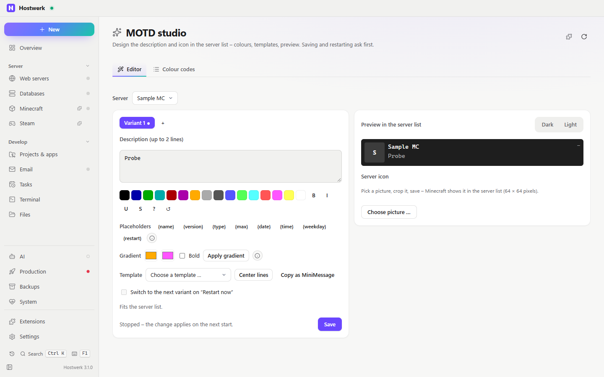

# MOTD studio

> **Merged into “Minecraft servers” (1.1):** the MOTD section stays in the overview of every server, the big editor is the tab “MOTD studio” in the server list. Hostwerk installs the new version by itself and removes this extension; variants stay. There are no new versions here.

Design your Minecraft server's description in the server list – with colours, gradients, placeholders, variants and a preview like in the game. Right in the overview of every Minecraft server.

[Deutsch](README.de.md) · An official [Hostwerk](https://github.com/Passimoritz/hostwerk-public) extension (runs sandboxed, Hostwerk 3.1 or newer)

## What it does

Also an **example of an extension that changes Hostwerk itself**:

- **Section in the overview of every Minecraft server** (`contributes.sections`, `on: "mc.overview"`, Hostwerk with SDK 3.2 and newer) – preview like in the server list, “Edit” opens the editor right there. Hostwerk passes the server as `Hostwerk.context`.
- **Fallback for older Hostwerk versions:** the previous tab (`contributes.tabs` with `"fallback": true`) only appears where there are no sections yet.
- **Action in the right-click menu and the quick search** (`contributes.actions`) – opens the editor for that server (`Hostwerk.on('action')`).
- **Changes a Hostwerk setting** (`Hostwerk.put('/mc/servers/<id>/properties', { motd })`) with the `change:minecraft` permission – Hostwerk asks before every change.
- **Tabs drawn by Hostwerk** (`page.tabs`) and Hostwerk's own design classes (`card`, `btn primary`, `select` …).

## What it does

- **Where:** Minecraft server → Overview (section) – no own sidebar entry since 1.4.0; the full page stays under Extensions → Open
- Colour buttons (§0–§f, each with its name for screen readers) and formats (bold, italic, underline, strikethrough, obfuscated §k, reset) – wraps a selection
- **Placeholders** `{name}` `{version}` `{type}` `{max}` `{date}` `{time}` `{weekday}` `{restart}` (next planned restart from Hostwerk's tasks). Honestly: Minecraft only reads the description at start – the studio fills in the values when saving and on “Restart now”. Players online are shown next to it in the server list anyway, so there is no placeholder for that.
- **Gradients** over Minecraft's 16 colours (that is all `server.properties` knows) and **“Copy as MiniMessage”** for real hex colours with plugins like MiniMOTD on Paper
- **Up to 5 variants** – optionally “Restart now” switches to the next one
- **Preview dark and light**
- Templates (welcome, survival, event, maintenance, creative, info with version and restart, weekday and date) and “Center lines” – measured with the widths of Minecraft’s font
- Live preview like the Minecraft server list
- Server icon: pick a picture, zoom and move the crop, save as 64 × 64 PNG (`change:minecraft`, asks first)
- After saving on a running server: “Restart now” (`control:services`, asks first)
- The server list stays live (new servers, started/stopped) without losing what you typed
- Checks: more than 2 lines, lines that get cut off, unknown codes
- Table of all colour codes
- Error state with “Try again”; polling pauses while the page is hidden; sits under “Servers” next to Minecraft; other extensions may add tabs – for example a Bedrock MOTD tab from the Bedrock bridge

## Install

In Hostwerk: **Extensions → Discover** and click “Install”. Or manually: download the zip from the [latest release](../../releases/latest) → *Extensions → Add → File*.

It runs sandboxed in Hostwerk – it only gets the permissions it lists, and Hostwerk shows them before installing.

## Permissions

| Permission | Why |
|---|---|
| `read:minecraft` | Read the servers and their current description |
| `change:minecraft` | Save the description to `server.properties` and the server icon (asks first) |
| `control:services` | “Restart now” after saving (asks first) |
| `read:tasks` | Next planned restart for `{restart}` |
| `storage` | Remember templates with placeholders and variants |

## Develop

Logic in `page/lib.js` (no DOM), polling and error state in `page/live.js`, tests: `node --test tests/*.test.js`. Check: `node check.js . --strict` (Hostwerk SDK). The release packs everything except the repository tooling.

## License

MIT
